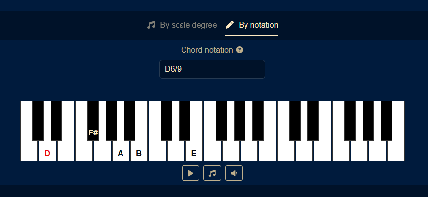
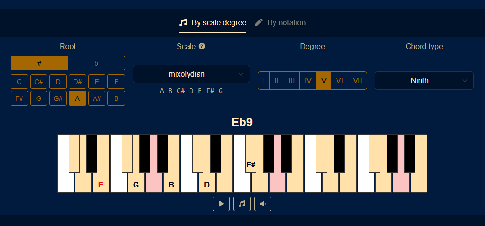

# Junior Composer Friend

A small interactive music theory tool to explore chords and scales on a virtual piano.

## Demo

**Live app:** https://jcf.mp3000.fr/

<table>
  <tr>
    <td align="center"><b>By notation</b> Type any chord name to see it on the piano  </td>
    <td align="center"><b>By scale degree</b> Pick a root, scale, degree and chord type  </td>
  </tr>
</table>

## Features

- **By scale degree** — pick a root note, a scale (Ionian, Dorian, Mixolydian…), a degree (I–VII), and a chord type (triad or tetrad). The resulting chord is named and highlighted on the piano.
- **By notation** — type any chord name (e.g. `Dm7`, `Fmaj9`) and see it displayed on the piano.

## Contributing

Contributions are welcome. See [CONTRIBUTING.md](CONTRIBUTING.md).

## License

[MIT](LICENSE)
